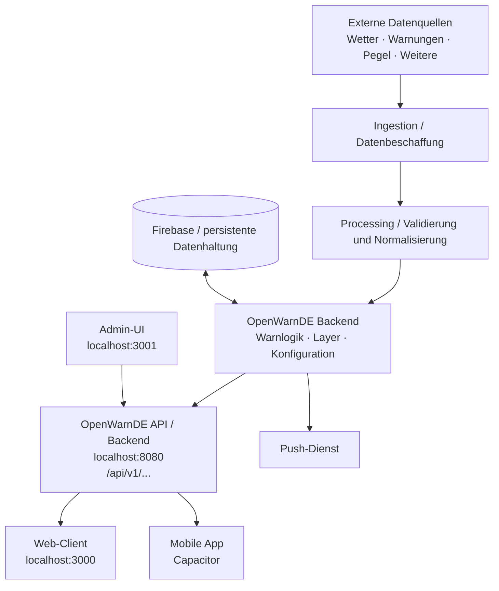

# OpenWarnDE 2.0 – Zielarchitektur

**Architekturvariante:** Modularer Monolith mit klaren Schnittstellen

## 1. Architekturziele

Die neue Plattform soll die gewachsene OpenWarnDEV-Struktur durch eine klare Trennung von Client, API, Backend, Datenverarbeitung und Verwaltung ersetzen. Der Client ist ausschließlich Darstellung und Bedienung; externe Datenquellen, Normalisierung, Warnlogik und Berechtigungsprüfung liegen zentral im Backend.

Die Architektur muss mindestens drei fachliche Module klar voneinander trennen, neue Datenquellen ohne Clientänderung ermöglichen und spätere Erweiterungen um weitere Betriebsmodi erlauben.

## 1.1 Lokale Serveraufteilung

Die Entwicklungsumgebung besteht aus drei getrennten Serverprozessen:

|   Port | Prozess             | Inhalt und Verantwortung                                                                                                                     |
| -----: | ------------------- | -------------------------------------------------------------------------------------------------------------------------------------------- |
| `3000` | Client-Server       | Öffentliche Webanwendung für Nutzer: Karte, Standort, Suche, Layer und Warnungsanzeige.                                                      |
| `3001` | Admin-UI-Server     | Ausschließlich die Verwaltungs-Webanwendung. Sie rendert Admin-Seiten und ruft die API auf.                                                  |
| `8080` | API-/Backend-Server | Eigenständiger Backendserver für API, Authentifizierung, Autorisierung, Datenverarbeitung, Persistenz, Warnungen, Wetter und Push-Steuerung. |

Der API-Server auf `8080` ist unabhängig vom Admin-UI-Server. Die Verwaltungs-UI ist lediglich ein Client des Backends. Auch der öffentliche Client auf `3000` kommuniziert ausschließlich über die API.

### Lokale Kommunikationswege

```text
Browser/Nutzer ──> http://localhost:3000      (öffentlicher Client)
Browser/Admin  ──> http://localhost:3001      (Verwaltungs-UI)
                         │
                         └──────────────┐
Browser/Nutzer ─────────────────────────┼──> http://localhost:8080
                                       │     (OpenWarnDE API/Backend)
Externe Wetter-/Warnquellen ───────────┘
```

Die beiden UIs dürfen keine direkte Datenbankverbindung, keinen direkten Zugriff auf interne Dateien und keine direkte Verarbeitung von API-Schlüsseln erhalten. CORS, erlaubte Origins und API-Basis-URLs werden für die drei lokalen Ports ausdrücklich konfiguriert.

## 1.2 Deploymentziel Firebase

Während der Entwicklung laufen alle drei Bestandteile über `localhost`. Nach Fertigstellung werden Client, Admin-UI, API und Datenhaltung in eine Firebase-Zielumgebung überführt. Dafür sind getrennte Deployments, Produktions- und Entwicklungsvariablen, HTTPS, produktive Authentifizierung sowie die Überführung der lokalen Datenhaltung in eine geeignete Firebase-Datenhaltung vorzusehen.

Port `8080` ist der lokale Entwicklungsport des Backends und nicht die Festlegung für die spätere Firebase-URL.

## 2. Variantenentscheidung

| Variante                         | Bewertung                                                                              |
| -------------------------------- | -------------------------------------------------------------------------------------- |
| A: Bestehende Struktur erweitern | Geringer Startaufwand, aber bestehende strukturelle Probleme bleiben erhalten.         |
| B: Vollständige Microservices    | Gute physische Trennung, aber für den 80-Stunden-MVP zu komplex und betriebsaufwendig. |
| C: Modularer Monolith            | Klare fachliche Trennung bei überschaubarer Komplexität; für den MVP ausgewählt.       |

Variante C ist verbindlich für den MVP. Einzelne Module dürfen später in eigenständige Services ausgelagert werden, wenn ein konkreter technischer oder wirtschaftlicher Vorteil entsteht.

## 3. Zielsystem



## 4. Fachliche Module

```text
server/src/
├── app/api/                 # öffentliche und administrative API-Routen
└── lib/
    ├── api/                 # DTOs, Fehlerformat, Versionsregeln
    ├── ingestion/           # Abruf externer Quellen
    ├── processing/          # Validierung, Normalisierung, Aggregation
    ├── weather/             # Wetterquellen und Wetterkacheln
    ├── warnings/            # Warnungen, Gebiete, Status und Priorität
    ├── notifications/      # Push-Vorbereitung und Versand
    ├── usage/               # spätere Nutzungs- oder Abrechnungsgrenzen
    └── shared/              # technische Hilfsfunktionen und Typen
```

### 4.1 Client auf Port 3000

Der Client übernimmt Kartenanzeige, Standortfreigabe, Suche, Layerauswahl und Warnungsdetails. Er ruft den API-Server auf `localhost:8080` auf. Er verarbeitet keine API-Schlüssel und enthält keine sicherheitskritische Autorisierungslogik.

### 4.2 Verwaltungs-UI auf Port 3001

Die Verwaltungs-UI ist eine eigenständige Webanwendung auf `localhost:3001`. Sie enthält Formulare und Ansichten für Konfiguration, Warnungen, Rollen und Push-Aktionen. Sie steuert das Backend ausschließlich über authentifizierte API-Aufrufe an `localhost:8080`.

Die Admin-UI darf keine fachliche Logik duplizieren, keine Datenbank direkt öffnen und keine Berechtigung ausschließlich im Browser durchsetzen.

### 4.3 API-/Backend-Server auf Port 8080

Der Server auf `localhost:8080` ist der zentrale und eigenständige Backendserver. Er stellt die versionierte API bereit und enthält Authentifizierung, Autorisierung, Datenbeschaffung, Verarbeitung, Persistenz, Warnungslogik, Wetterlogik und Push-Steuerung. Sowohl Client als auch Verwaltungs-UI sind von diesem Server abhängig.

### 4.4 Ingestion

Dieses Modul ruft externe Quellen ab, behandelt Timeouts und Anbieterfehler und liefert Rohdaten an die Verarbeitung. Jede Quelle wird über einen Adapter integriert, damit Anbieter ausgetauscht werden können.

### 4.5 Processing

Dieses Modul validiert, normalisiert und vereinheitlicht unterschiedliche Quellformate. Die Ausgabe ist ein internes OpenWarnDE-Modell.

### 4.6 Warnings

Das Warnungsmodul verwaltet Warnung, Titel, Beschreibung, Priorität, Gebiet, Status, Gültigkeitszeitraum und Quelle. Es stellt öffentliche Projektionen bereit.

### 4.7 Notifications

Das Benachrichtigungsmodul nimmt eine veröffentlichte Warnung entgegen und übergibt sie an den konfigurierten Push-Dienst. Versand, Einwilligung, Rate Limits und Fehler werden getrennt von der Warnung behandelt.

### 4.8 Authentifizierung und Autorisierung

Administrative Zugriffe werden serverseitig geprüft. Das Rollenmodell muss vor der Umsetzung festgelegt werden, mindestens mit einer Rolle für normale Nutzer und einer Rolle für Administratoren.

## 5. Datenfluss

1. Eine externe Datenquelle liefert Rohdaten.
2. Ein Ingestion-Adapter ruft die Daten mit Timeout und Fehlerbehandlung ab.
3. Processing validiert und normalisiert die Daten.
4. Das Backend speichert bzw. cached das interne Modell.
5. Die API erzeugt eine öffentliche, secretsichere Antwort.
6. Web-Client oder Capacitor-App stellt die Daten auf der Karte dar.
7. Bei einer manuell erstellten Warnung prüft das Backend die Berechtigung.
8. Nach Veröffentlichung kann das Backend den Push-Versand auslösen.

## 6. Technologieentscheidungen aus der Projektplanung

| Bereich              | Zieltechnologie                                       | Begründung                                                                   |
| -------------------- | ----------------------------------------------------- | ---------------------------------------------------------------------------- |
| Frontend             | Next.js, React, TypeScript                            | Wiederverwendung vorhandener Kenntnisse, Komponentenmodell und Typprüfung.   |
| Karte                | MapLibre GL JS                                        | Unterstützung für moderne Karten, 3D-Terrain, 3D-Gebäude und flexible Layer. |
| Mobile               | Capacitor                                             | Wiederverwendung des Web-Clients für unterstützte mobile Plattformen.        |
| Backend/API          | Next.js bzw. TypeScript-Modularer-Monolith            | Gemeinsame Sprache, einfacher MVP-Betrieb und klare API-Routen.              |
| Datenhaltung/Hosting | Firebase                                              | Geplante Basis für Hosting, persistente Daten und ergänzende Dienste.        |
| Versionierung        | GitHub                                                | Nachvollziehbare Entwicklungsstände und CI/CD-Grundlage.                     |
| Qualität             | ESLint, TypeScript, automatisierte und manuelle Tests | Frühe Fehlererkennung und nachvollziehbare Abnahme.                          |

Der aktuelle Repository-Code kann von diesen Zielentscheidungen abweichen. Insbesondere die Kartenimplementierung und bereits vorhandene Wetterlogik müssen vor einer Migration bewusst bewertet werden.

## 7. Schnittstellen

### Technisch

- Client ↔ OpenWarnDE API
- App ↔ OpenWarnDE API
- API ↔ Datenverarbeitung
- Datenverarbeitung ↔ externe Quellen
- Backend ↔ Datenhaltung
- Backend ↔ Push-Dienst
- Kartenengine ↔ Kartendaten
- GitHub ↔ CI/CD und Deployment

### Organisatorisch und personell

Das Projekt ist ein Einzelprojekt. Der Projektbearbeiter übernimmt Planung, Analyse, Architektur, Entwicklung, Qualitätssicherung und Dokumentation.

## 8. Sicherheits- und Datenschutzanforderungen

- API-Schlüssel und interne Quellen bleiben serverseitig.
- Admin-Schreibzugriffe werden serverseitig authentifiziert und autorisiert.
- Standortermittlung erfolgt erst nach Einwilligung und nur für den erforderlichen Zweck.
- Push-Empfänger benötigen eine nachvollziehbare Einwilligung.
- Fehlerantworten dürfen keine Secrets oder internen Stacktraces enthalten.
- Externe Quellen erhalten Timeouts, Fehlerbehandlung und kontrolliertes Caching.

## 9. Zielstruktur für die Implementierung

```text
client/
└── src/
    ├── app/
    ├── components/map/
    ├── components/warnings/
    ├── components/admin/
    └── lib/api/

server/
└── src/
    ├── app/api/v1/          # API-Routen des Servers auf Port 8080
    ├── app/api/admin/       # ebenfalls auf Port 8080, nicht auf Port 3001
    └── lib/
        ├── ingestion/
        ├── processing/
        ├── warnings/
        ├── notifications/
        ├── usage/
        └── shared/
```

## 10. Offene Architekturentscheidungen

Vor der Umsetzung sind Push-Anbieter, Firebase-Dienste, Authentifizierungsverfahren, Warnungsdatenmodell, Suchdienst, mobile Zielplattformen und die konkrete MapLibre-Datenquelle festzulegen. Zusätzlich sind Startbefehle und Umgebungsvariablen für die drei lokalen Server (`3000`, `3001`, `8080`) zu definieren. Diese Entscheidungen werden als ADR oder im Projektverlauf dokumentiert.
